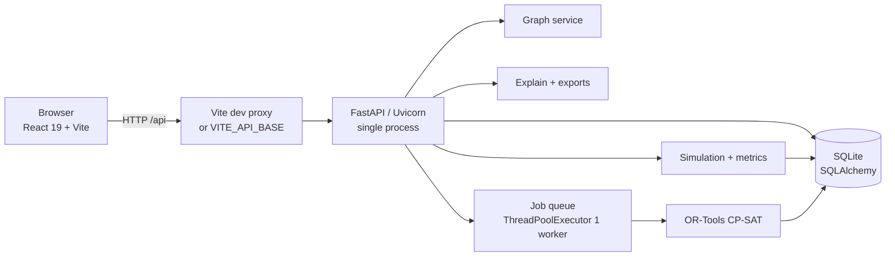
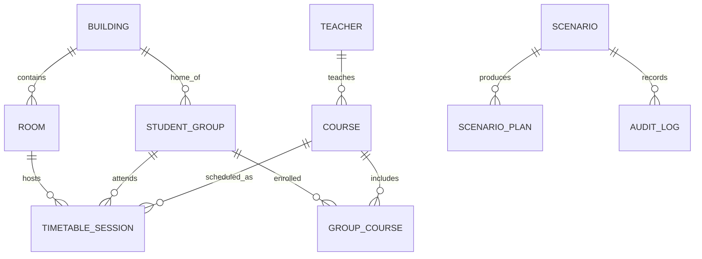
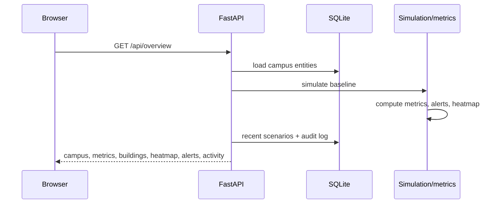
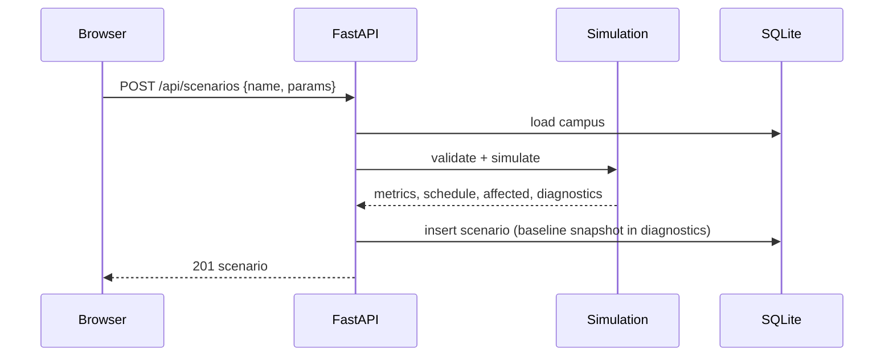
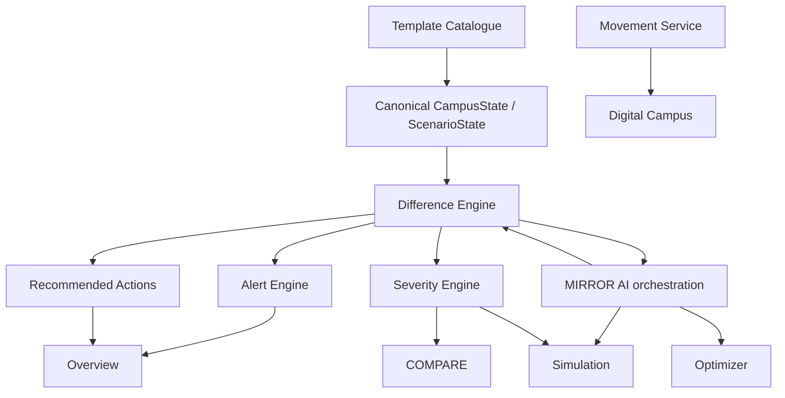

# MIRRORWORLD — System Architecture (As Built)

**Snapshot:** `5a9f888` · 31 October 2026, updated after Phase 1–2 implementation  
**Scope:** the current repository. Sections 1–11 describe the audited baseline plus the additive Phase 1–2 modules; §12 lists what remains for Phases 3–4.

> **Implementation update.** Phase 1 added canonical campus/scenario state, the Digital Twin Difference Engine, a verified constructive fallback (`FEASIBLE_HEURISTIC`), atomic plan replacement and honest solver statuses. Phase 2 added structured alerts, evidence-based recommendations, severity assessment, five extended scenario parameters and seven server-side templates. Phase 3 added the timetable-based student movement service (`movement.py`), the `/api/movement` endpoint, SVG flow visualization, tight transition highlighting, and unverified distance detection on Digital Campus. These are additive modules; the existing workflow and screens are preserved. Phase 4 added MIRROR AI: `ai.py` holds an env-configured provider transport (Google `generateContent`, primary/fallback model, timeout and bounded retries) plus a deterministic rule engine, while `api.py` assembles the grounding context from the services above and exposes `GET /api/ai/status` and `POST /api/ai/chat`. With no key configured every answer is labelled rule-engine output; a provider failure degrades to it with an explicit error rather than a fabricated success.

---

## 1. Purpose and context

MIRRORWORLD is a single-operator campus digital twin. It models a synthetic university campus, recomputes timetable diagnostics, applies counterfactual disruptions without mutating the baseline, solves recovery plans with Google OR-Tools CP-SAT, and presents the evidence through a React workspace.

Central product workflow:

```
MODEL → DETECT → SIMULATE → OPTIMIZE → COMPARE → EXPORT
```

The system is deliberately local-first: one FastAPI process, one SQLite file, one browser session, no authentication and no external service. The upgrade specification adds interpretation layers (alerts, recommendations, severity, movement, AI) on top of the existing computational core.

---

## 2. Runtime topology



- **Frontend:** React 19, TypeScript, Vite, Tailwind, TanStack Query, Zustand, Recharts, custom SVG.
- **Backend:** FastAPI, Pydantic v2, SQLAlchemy 2, OR-Tools CP-SAT.
- **Persistence:** SQLite by default (`backend/data/mirrorworld.db`), configurable with `MIRRORWORLD_DATABASE_URL`.
- **Concurrency:** synchronous request handlers; CP-SAT runs in a single background worker thread. No broker, no multi-process worker.
- **Deployment:** the repository contains a Netlify build config for the frontend only. The API must be hosted separately (or run locally); the CORS allowlist names one Netlify origin plus localhost.

---

## 3. Repository map

```
backend/
  app/
    main.py        FastAPI app, lifespan seed, CORS
    api.py         all HTTP routes (prefix /api)
    db.py          engine, session factory, declarative base
    models.py      SQLAlchemy entities
    schemas.py     request validation (scenario, optimizer, edits)
    catalog.py     static synthetic campus, days, slots, distances
    seed.py        deterministic campus + pinned baseline conflicts
    campus.py      load/serialise campus, feasibility helpers
    metrics.py     conflict, capacity, facility, utilisation, energy, movement
    simulation.py  counterfactual context, displacement, affected set,
                   extended parameters and shared validation
    state.py       canonical baseline/effective state snapshots (JSON)
    difference.py  state diff, change consequences, constraint effects, decisions
    alerts.py      structured, severity-graded alerts with evidence and actions
    recommendations.py  evidence-based operational recommendations
    severity.py    deterministic Low/Medium/High/Critical assessment
    templates.py   seven campus-derived scenario templates
    movement.py    timetable-based student movement transitions and feasibility
    ai.py          Mirror AI provider transport + deterministic rule engine
    optimizer.py   CP-SAT model, three plans, constructive seed,
                   verified FEASIBLE_HEURISTIC fallback, independent audit
    jobs.py        in-process job registry, worker, demo seeding
    graph.py       dependency graph and bounded impact BFS
    explain.py     comparison rows, deltas, plan recommendation, narrative
    exports.py     CSV schedules, scenario CSV, printable HTML report
  tests/
    conftest.py    temp database + seeded fixtures
    test_mirrorworld.py
    test_movement.py
frontend/
  src/
    App.tsx        routes and error boundary
    config/nav.ts  navigation metadata
    lib/api.ts     typed fetch client
    lib/hooks.ts   TanStack Query hooks and keys
    lib/types.ts   API contracts
    lib/utils.ts   formatting and tone helpers
    store/         Zustand UI state + toasts
    components/    design system, charts, timetable, shell
    pages/         one screen per workspace
  vite.config.ts   port 5173, /api proxy to 127.0.0.1:8000
netlify.toml       frontend build (base frontend, publish dist)
README.md          run, test and limitation notes
```

---

## 4. Domain model and persistence

### 4.1 Entity relationship



### 4.2 Tables

| Table | Key fields | Notes |
| --- | --- | --- |
| `buildings` | `id`, `code`, `name`, `zone`, `purpose`, `floors`, `map` (JSON), `accent` | `map` is illustrative geometry `{x,y,w,h}` |
| `rooms` | `id`, `building_id`, `code`, `name`, `kind` (`classroom`/`lab`), `lab_types`, `capacity`, `floor`, `power_kw`, `equipment`, `equipment_kw` | Equipment is a static tag list, not inventory |
| `teachers` | `id`, `name`, `department`, `title`, `max_weekly_hours`, `unavailable` | `unavailable` is a list of `[day, slot]` pairs |
| `student_groups` | `id`, `name`, `department`, `batch`, `size`, `home_building_id` | Size is the enrolment used in capacity/seat metrics |
| `courses` | `id`, `code`, `title`, `department`, `teacher_id`, `weekly_sessions`, `length`, `needs_lab`, `required_equipment`, `color` | `length` is in slots (1 or 2) |
| `group_courses` | `group_id`, `course_id` | Unique pair; many-to-many enrolment |
| `timetable_entries` | `id`, `course_id`, `group_id`, `sequence`, `length`, `room_id`, `day`, `start_slot` | Baseline timetable; nullable placement is supported |
| `scenarios` | `id`, `name`, `kind`, `params`, `status`, `metrics`, `schedule`, `affected`, `warnings`, `assumptions`, `diagnostics`, timestamps | JSON-heavy; `diagnostics` holds baseline snapshot and solver metadata |
| `scenario_results` | `scenario_id`, `label`, `name`, `strategy`, `status`, `solver_status`, `objective`, `metrics`, `schedule`, `assignments`, `warnings`, `assumptions`, `audit`, `objective_terms`, `runtime_seconds` | One row per plan B/C/D |
| `audit_log` | `id`, `action`, `scenario_id`, `actor`, `timestamp`, `detail` | Actions include scenario creation, optimization start/completion/cancel/failure, campus edits, dataset reset |

All JSON columns are SQLAlchemy `JSON`; the schema avoids SQLite-specific SQL, so PostgreSQL is plausible, though no PostgreSQL test or migration is included.

### 4.3 Scenario lifecycle

```
created / simulated
      │
      ├─ POST /optimize ──> optimizing ──> optimized   (≥1 audited feasible plan)
      │                          │
      │                          ├────────> infeasible (precheck or solver proof)
      │                          └────────> failed     (unexpected exception)
      │
      └─ cancel ─────────────────> simulated (plans deleted)
```

Plan statuses stored per row: `OPTIMAL`, `FEASIBLE`, `FEASIBLE_HEURISTIC`, `INFEASIBLE`, `AUDIT_FAILED`, `UNKNOWN`. `FEASIBLE_HEURISTIC` is a constructive schedule that passed the independent audit after CP-SAT returned `UNKNOWN`; it is usable but never presented as optimal or solver-confirmed. New plans are persisted atomically, so a failed run does not delete the previous plan set.

---

## 5. API surface

All routes are under `/api`. No authentication is required.

| Method | Path | Handler | Purpose |
| --- | --- | --- | --- |
| GET | `/health` | `health` | Service, OR-Tools version, dataset label |
| GET | `/campus` | `get_campus` | Campus model, baseline metrics/schedule, fingerprint, summary |
| PATCH | `/campus/rooms/{id}` | `update_room` | Rename or change capacity; writes audit log |
| PATCH | `/campus/teachers/{id}` | `update_teacher` | Change weekly hour limit |
| PATCH | `/campus/groups/{id}` | `update_group` | Change cohort size |
| POST | `/campus/reset` | `reset_campus` | Delete all entities and reseed; blocked while a job is active |
| GET | `/overview` | `overview` | KPI payload, heatmap, building summary, alerts, recommendations, severity, recent runs, activity |
| GET | `/alerts` | `get_alerts` | Structured alerts for the baseline or `?scenario_id=` |
| GET | `/recommendations` | `get_recommendations` | Evidence-based actions for the baseline or `?scenario_id=` |
| POST | `/assess` | `assess_scenario` | Preliminary severity assessment without persisting a scenario |
| GET | `/templates` | `get_templates` | Seven campus-derived scenario templates |
| GET | `/scenarios` | `list_scenarios` | Recent scenario summaries |
| POST | `/scenarios` | `create_scenario` | Validate params, simulate synchronously, persist snapshot |
| GET | `/scenarios/{id}` | `get_scenario` | Full scenario, plans, affected set, diagnostics, difference, severity |
| GET | `/scenarios/{id}/difference` | `scenario_difference` | Digital Twin Difference Engine report |
| POST | `/scenarios/{id}/optimize` | `optimize_scenario` | Queue a CP-SAT job; returns 202 + job |
| GET | `/jobs/{id}` | `poll_job` | Job status/progress/result |
| POST | `/jobs/{id}/cancel` | `cancel_optimize_job` | Request cancellation between plans |
| GET | `/compare` | `compare` | Baseline/scenario/plan metrics, rows, narrative, recommendation |
| GET | `/graph` | `get_graph` | Dependency graph for baseline or scenario |
| GET | `/graph/impact` | `graph_impact` | Bounded BFS around a node, with alternatives |
| GET | `/history` | `history` | Runs and audit log |
| GET | `/export/baseline.csv` | `export_baseline` | Baseline timetable CSV |
| GET | `/export/scenarios/{id}.csv` | `export_scenario` | Scenario + plan metrics and affected ledger |
| GET | `/export/scenarios/{id}/plans/{label}.csv` | `export_plan` | Plan timetable CSV |
| GET | `/scenarios/{id}/report` | `scenario_report` | Printable HTML report |

**Error behaviour:** 404 for unknown scenario/job/node; 422 for validation failures; 409 for duplicate active job, reset while solving, or export of a plan without a schedule. FastAPI’s default validation errors are surfaced by the typed client.

---

## 6. Computation engines

### 6.1 Metrics (`metrics.py`)

`compute_metrics(campus, sessions, group_sizes, energy_factor, operating_end_slot, available_room_ids)` is the single source for all KPIs.

| Metric | Formula / rule | Caveat |
| --- | --- | --- |
| Scheduled sessions | Sessions with a room, day and start slot | Displaced sessions are counted separately |
| Conflicts | Pairwise collision per `(resource, day, slot)` for rooms, instructors and cohorts; deduplicated by resource type + session pair | `conflicts_total` is a pair count, not a doubled-slot count |
| Capacity | Per scheduled session, `group_size > room.capacity` | Deficit = group size − capacity |
| Facility fit | Lab session must use a lab whose `lab_types` includes `needs_lab`; required equipment tags must be present | No equipment quantity/inventory |
| Availability | Session start slots must not intersect teacher `unavailable` pairs | Baseline violations are reported, not auto-repaired |
| Room hours | Σ(session length × 1.5 h) | Only scheduled sessions |
| Room utilisation | scheduled room-hours ÷ (available rooms × 5 days × (end_slot+1) × 1.5 h) | 5 days hard-coded |
| Active-room utilisation | scheduled room-hours ÷ (rooms used × 5 × (end_slot+1) × 1.5 h) | Complement documented in UI |
| Seat utilisation | Σ(group size × duration) ÷ Σ(room capacity × duration) | Only scheduled sessions |
| Energy | Σ(length × 1.5 h × (room kW + lab equipment kW if lab)) × energy factor | Estimated from ratings; overlapping sessions double-count |
| Peak demand | max over slots of Σ unique room power at that slot | Conservative `max` per room; can disagree with energy under overlap |
| Teacher load | Σ(session length × 1.5 h) per teacher | Contact hours only |
| Workload σ | Population standard deviation of teacher loads | — |
| Overload | Teacher load > `max_weekly_hours` | — |
| Movement | Σ building-to-building distance between consecutive cohort sessions per day | Unweighted by cohort size; no walking time; within-building = 0 |
| Gaps | Σ positive gaps between consecutive cohort sessions; average over pairs | Not compared with travel time |
| Hard issues | Conflicts + capacity + facility + availability + displaced | A plan is clean only when zero |

The API caps detail arrays at 120 records (`MAX_DETAILS`); aggregate counts remain exact.

### 6.2 Simulation (`simulation.py`)

1. `validate_params` rejects unknown rooms/instructors, invalid enrolment/window/policy/energy values and an all-rooms-closed scenario.
2. `build_context` computes effective group sizes with largest-remainder rounding, available rooms, end slot, lab policy and energy factor.
3. `apply_scenario` deep-copies each baseline session and marks it displaced if:
   - its room is closed;
   - its instructor is absent;
   - its start/end falls outside the operating window;
   - it is a lab session and policy is afternoon-only but it starts before slot 3.
   Displaced sessions lose room/day/slot and keep a reason/detail.
4. `compute_metrics` recomputes all diagnostics against the disrupted schedule and the **effective** group sizes and room pool.
5. `build_affected` turns metric details into a per-session ledger with `direct`/indirect flags and a resource index (rooms, teachers, groups, courses).
6. `simulate` returns metrics, schedule, affected, warnings, assumptions and diagnostics (`baseline_immutable: true`, context).

The baseline `campus.sessions` is never mutated. Displacement is deterministic.

### 6.3 Dependency graph (`graph.py`)

- Nodes: buildings, rooms, teachers, groups, courses, sessions, equipment tags (227 nodes on the demo dataset).
- Edges: `located_in`, `has_equipment`, `taught_by`, `requires`, `enrolled_in`, `scheduled_as`, `attended_by`, `assigned_to`.
- `build_graph` optionally accepts a scenario schedule and marks affected nodes from `scenario.affected`.
- `impact_analysis` performs a bounded BFS (default depth 3), returns direct/indirect nodes and summary counts.
- Alternatives currently use the maximum cohort size across the campus (`graph.py:226`), not the affected course’s cohort; this can exclude valid rooms.

### 6.4 Optimizer (`optimizer.py`)

**Decision variables**

- `room[s, r] ∈ {0,1}` for each eligible session/room pair.
- `start[s] ∈ Domain(allowed global slot indices)`.
- `room_used[r] ∈ {0,1}` via `AddMaxEquality`.
- `group_building[g, b] ∈ {0,1}` for movement concentration.

**Constraints**

- Exactly one room per session.
- Room capacity and lab/equipment eligibility (pre-filtered eligible rooms).
- Teacher availability and operating window/lab policy in the start domain.
- `AddNoOverlap` for room intervals, teacher intervals and cohort intervals.
- Optional room-count cap for Plan D, with a disclosed fallback if infeasible.

**Objective (actual)**

```
min  w_energy   · normalized(energy choice cost)
   + w_util     · room-opening cost (number of rooms used)
   + w_move     · number of distinct (group, building) pairs
```

Coefficients are normalized by the feasible range of each term. This is **not** the “capacity slack” objective described on the Method page; documentation alignment is a Phase 1 task.

**Plan generation**

| Plan | Strategy | Weights |
| --- | --- | --- |
| B | Maximize space utilisation | utilization 1.0 |
| C | Minimize energy demand | energy 1.0 |
| D | Balanced / analyst weights | normalized user weights |

- A deterministic greedy pass builds a valid incumbent and an objective upper bound; CP-SAT is hinted with it (`use_optimization_hints`, `repair_hint`).
- Solver: `num_search_workers=1`, `random_seed=42`, `max_time_in_seconds` per plan.
- Statuses are stored verbatim (`OPTIMAL`, `FEASIBLE`, `INFEASIBLE`, `MODEL_INVALID`, `UNKNOWN`); the plan is only `FEASIBLE` if the independent audit passes.

**Audit (`audit_solution`) — 9 checks**

1. Every session assigned exactly once.
2. Room capacity upheld.
3. Lab type and equipment match.
4. Instructor availability upheld.
5. Operating window upheld.
6. No room double-booking.
7. No instructor double-booking.
8. No student-group double-booking.
9. Weekly teaching limits upheld.

The audit is implemented independently of the CP-SAT model and runs on the extracted schedule.

### 6.5 Explanation and recommendation (`explain.py`)

- `comparison_rows` builds 19 metric rows with baseline, scenario, optional plan, absolute/percentage deltas and a direction-aware “better” flag. Zero denominators return `percent: null`, never an exception.
- `recommend_plan` scores feasible plans by weighted normalized distance to the best observed energy, rooms used and movement. Any hard issue or failed audit adds a 5.0 penalty; the lowest score wins; ties prefer Plan D.
- `build_explanation` emits rule-based statements (displacement, constraints, recovery coverage, energy, utilisation, movement, trade-offs, failed candidates, evidence boundary). It quotes computed metrics only; there is no generative model in this path.

### 6.6 Jobs (`jobs.py`)

- `EXECUTOR = ThreadPoolExecutor(max_workers=1)`.
- `JOBS: dict[str, dict]` in process memory; `JOB_LOCK` guards updates.
- Statuses: `queued`, `running`, `cancelling`, `completed`, `cancelled`, `infeasible`, `failed`.
- Progress stages: `loading`, `building`, `solving`, `solved`, `completed`.
- Duplicate active job per scenario is rejected (`409`).
- Cancellation is cooperative between plans. New plans are staged and replaced atomically only after a solve produces a usable result, so a timeout or failure does not destroy the previous plan set.
- On completion, plans are written to `scenario_results`, scenario status is updated, and an `OPTIMIZATION_COMPLETED` audit entry is added.
- On infeasibility, diagnostics are stored under `scenario.diagnostics["infeasibility"]`.
- **No restart recovery:** if the process stops, jobs disappear and a scenario can remain `optimizing`.

### 6.7 Exports (`exports.py`)

- Baseline/plan timetable CSV: day, start/end, session ID, course, group, teacher, room, building, students, length, status.
- Scenario CSV: scenario metadata, parameters, metric columns (baseline, scenario, each plan), affected ledger, per-plan audit, assumptions/warnings.
- Printable HTML: recommendation, configuration, measured outcomes, computed findings, plan cards, affected sessions, assumptions; inline CSS; print-ready.
- All values come from stored data; the dataset label and synthetic disclaimer are included.

### 6.8 Difference, alerts, recommendations and severity (`state.py`, `difference.py`, `alerts.py`, `recommendations.py`, `severity.py`)

- `state.campus_state()` and `state.effective_state()` create JSON-safe snapshots of the baseline and the scenario the engines actually used; no engine mutates the live campus.
- `difference.diff_states()` compares both snapshots and emits stable change IDs, resource effects, harder constraints, decisions and a model-derived summary. It also consumes the simulation's affected ledger, so “what changed” is not re-derived per feature.
- `alerts.build_alerts()` turns computed metrics and schedule facts into severity-graded alerts with condition fingerprints, affected resources, consequences, evidence and router-backed actions. The same builder serves baseline and scenario views.
- `recommendations.build_recommendations()` ranks operating actions only when a computed signal supports them (building utilization gap, capacity pressure, conflict clusters, energy outliers, workload); every recommendation carries evidence and a confidence label.
- `severity.assess_severity()` runs the simulation and a deterministic weighted rubric (displaced sessions, affected sessions, seat deficit, collisions, closed rooms, absent instructors, modelled energy change, complete loss of a room category) and returns Low/Medium/High/Critical plus per-factor evidence.
- `templates.build_templates()` derives seven templates from the live campus; the client loads parameters and can edit every field before execution.

---

## 7. End-to-end flows

### 7.1 Load the Overview



Note: `overview()` computes the baseline once directly and again inside `_campus_payload()`; both build the same data. This is a known low-severity performance duplication.

### 7.2 Create a scenario



### 7.3 Optimize

```mermaid
sequenceDiagram
    participant B as Browser
    participant A as FastAPI
    participant J as Job worker
    participant O as CP-SAT
    participant DB as SQLite
    B->>A: POST /scenarios/{id}/optimize
    A->>A: validate + create job
    A-->>B: 202 {job}
    J->>J: load campus + params
    J->>O: solve Plans B/C/D
    O-->>J: assignments + solver status
    J->>J: compute metrics + independent audit
    J->>DB: persist plans; update scenario
    B->>A: GET /jobs/{id} (poll ~900 ms)
    A-->>B: progress / result
```

### 7.4 Compare

- `GET /api/compare?scenario_id=…&plan=…`
- Loads the stored baseline metrics/schedule (fallback to current baseline for seeded/legacy runs).
- Finds the requested plan (or first feasible).
- Builds 19 comparison rows and a rule-based explanation.
- Returns scenario detail, baseline schedule, selected plan schedule, rows and recommendation.

---

## 8. Frontend architecture

### 8.1 Routes

| Path | Page | Purpose |
| --- | --- | --- |
| `/` | Operations overview | KPIs, occupancy heatmap, timetable, alerts, recent runs |
| `/campus` | Digital campus | Interactive schematic map, availability board, room inspector |
| `/simulation` | Simulation studio | Parameter form, presets, affected ledger, disrupted timetable |
| `/dependencies` | Dependency explorer | Graph, filters, bounded impact analysis |
| `/optimizer` | Schedule optimizer | Weights, plan generation, plan audit, recovery timetable |
| `/comparison` | Scenario comparison | Baseline/scenario/plan metrics, frontier, narrative, exports |
| `/model` | Campus model | Edit room capacity, teacher limit, cohort size; reset |
| `/history` | Run history | Runs and audit trail |
| `/method` | Method & evidence | Formulas, constraints, limitations |
| `*` | NotFound | Explicit “page does not exist” state |

### 8.2 State and data fetching

- **TanStack Query** owns server state. Query keys cover health, campus, overview, scenarios, scenario detail, compare, graph, impact, history and job.
- Staleness: campus 30 s; overview 20 s; scenarios 10 s; scenario detail 5 s; compare 10 s; graph/impact 20 s; health 5 min.
- **Zustand** owns UI state: active scenario id/name, sidebar collapsed, mobile nav, command palette, alerts popover; `persist` stores only active scenario and sidebar.
- **Toasts** are a separate Zustand store; auto-dismiss after 5.2 s.
- `api.ts` is a thin typed fetch wrapper; `VITE_API_BASE` defaults to same-origin and Vite proxies `/api` to `127.0.0.1:8000` in development.

### 8.3 Presentation

- Design system in `components/ui.tsx` (panels, buttons, badges, fields, tabs, modal, toast, tooltip, segmented control, checkbox, empty/error/loading states).
- Charts in `components/charts.tsx`: bar meters, utilization ring, occupancy heatmap, sparkline, comparison bars, Pareto bubble chart.
- `TimetableGrid.tsx` renders group/room views by day and slot, with conflict outlines, displaced rows, detail modal and zoom controls.
- Pages are dense, instrument-panel style; the map and timetable are custom SVG/HTML rather than a charting library.
- No component test runner is configured; verification is `tsc -b`, Vite build, oxlint and manual browser checks.

---

## 9. Invariants and trust boundaries

### 9.1 Invariants

1. **Baseline immutability:** simulation and optimization operate on copies; only explicit `PATCH /campus/*` changes the model, and those are audited.
2. **Recomputation:** metrics and conflict counts are derived from schedules, not from seed labels or stored summaries.
3. **Truthful plan status:** a plan is `FEASIBLE` only if the independent audit passes; solver status is preserved. A CP-SAT `UNKNOWN` with a verified constructive schedule is labelled `FEASIBLE_HEURISTIC`, never `FEASIBLE` or `OPTIMAL`.
4. **Determinism:** the dataset is seeded; solver seed is 42; simulation is deterministic. Solver wall-clock results can still vary by machine/load.
5. **Evidence boundary:** synthetic data, estimates and measured-in-system values are labelled distinctly in the UI and docs.
6. **No hidden mutation on read:** GET endpoints do not modify scenarios; overview/campus recompute but do not persist.

### 9.2 Trust boundaries

- The browser is untrusted input. All scenario parameters are validated by Pydantic; room/instructor IDs are checked against the campus.
- There is **no authentication or authorization**. Anyone who can reach the API can edit the campus or reset the dataset. This is acceptable only for a local/competition demo.
- CORS allows `https://mirrorworld-project-showcase.netlify.app` and any localhost origin, with credentials disabled.
- No secrets are used today. A future AI key must remain server-side, never in `VITE_*` variables or the bundle.
- SQLAlchemy parameter binding is used; no raw SQL string interpolation in the API path.

---

## 10. Performance and reliability characteristics

| Aspect | Current behaviour | Implication |
| --- | --- | --- |
| Dataset size | 112 sessions, 24 rooms, 26 teachers, 24 cohorts | Small; CP-SAT solves in seconds |
| Solver | 3 plans × per-plan time limit; 1 worker, 1 thread | ~2–6 s per plan on the demo machine; CPU contention can cause `UNKNOWN` |
| Overview | Recomputes baseline twice; builds heatmap 5×7 | Minor duplicate work; still fast at this scale |
| Graph | 227 nodes / 525 edges; BFS depth ≤ 5 | Fast, but structural reachability can over-report impact |
| Payloads | Scenario detail includes full schedule + plans + diagnostics | Can grow with many runs; no pagination on plans |
| Job durability | In-memory only | Restart loses queued/running jobs; scenario may stay `optimizing` |
| Persistence | SQLite file, JSON columns | No concurrent writers beyond the single process; no migration framework |
| Frontend bundle | Single chunk > 500 kB warning | Acceptable for demo; code-splitting is a polish item |
| Accessibility | Keyboard support on map nodes, focus rings, reduced-motion CSS | No formal audit; charts lack full alternative tables |

---

## 11. Known limitations and technical debt

1. **Solver timing:** `UNKNOWN` at short limits can be presented as “no feasible schedule”; first test run showed two failures that a rerun did not reproduce.
2. **Five-day constants:** `range(5)`, `5 × slots`, `WEEK_SLOTS = 35` are scattered across seed, metrics, solver, overview and frontend. A Sun–Thu or six-day model would require a coordinated change.
3. **Objective drift:** the Method page describes capacity slack and a room-opening penalty; the model uses room count and group-building concentration.
4. **Graph alternatives:** uses the maximum cohort size, not the affected course’s cohort.
5. **Weekly limits:** enforced by a pre-solve gate and audit, not by a CP-SAT constraint.
6. **No equipment inventory:** equipment is a static tag list; “insufficient equipment availability” cannot be modelled.
7. **No building-level closure:** only individual rooms can be closed.
8. **Job registry is not durable:** no restart recovery; no external queue.
9. **Plan deletion on failure:** previous plans are removed before a new solve; a failure loses them.
10. **Seeded demo runs lack baseline snapshots:** comparisons fall back to the current baseline.
11. ~~**Alert contract is thin:** no consequences, suggested-action text, affected-resource fields or low/medium severity.~~ **Resolved in Phase 2.**
12. ~~**No Difference/Movement/AI services:**~~ Difference Engine, alerts, recommendations and severity are implemented; **movement visualization (Phase 3) and MIRROR AI (Phase 4) remain**.
13. **No auth, no migrations, no frontend test runner.**
14. ~~**UI copy drift:** “112 sessions”, “zone coordinates”, “minimal disruption”, cancellation message about keeping plans.~~ **Corrected in Phase 1.**
15. **Movement is still a weekly aggregate:** no per-transition walking-time, gap-violation or congestion payload yet.
16. **In-memory job registry remains:** a backend restart during an optimization loses the running job (Phase 3 hardening).

---

## 12. Extension points: implemented and remaining

The upgrade grew around the existing engines rather than replacing them. Phase 1–2 modules are live; Phase 3–4 modules remain.



| Module | Responsibility | Depends on | Feeds | Status |
| --- | --- | --- | --- | --- |
| `state.py` | Canonical baseline/effective state; snapshot serialization | campus, models | difference, simulation, optimizer | **Implemented** |
| `difference.py` | Change list, affected resources, constraint effects, decisions | state, graph | alerts, severity, recommendations, UI | **Implemented** |
| `alerts.py` | Structured alerts with evidence, consequences, actions | metrics, difference | overview, top bar | **Implemented** |
| `recommendations.py` | Evidence-based operational actions | metrics, difference, campus | overview, simulation | **Implemented** |
| `severity.py` | Deterministic Low/Medium/High/Critical assessment | metrics, affected, difference | simulation, comparison, overview | **Implemented** |
| `templates.py` | Seven template definitions and parameter builders | campus, state | simulation studio | **Implemented** |
| `movement.py` | Per-transition flows, walk time, slack, congestion index | schedule, campus, distances | digital campus, comparison | **Implemented (Phase 3)** |
| `ai.py` | Provider-agnostic model transport, fallback model, deterministic rule engine | env config, campus, metrics, alerts, difference, movement | mirror AI | **Implemented (Phase 4)** |
| `ai/` | Provider abstraction, intent→draft, tools, grounding, guardrails | difference, severity, simulation, optimizer | copilot UI | **Phase 4** |

**State and data (implemented)**

- `Scenario.diagnostics["state"]` stores `{baseline, effective}` JSON snapshots at creation; legacy scenarios without a snapshot return a partial-evidence diff instead of guessing.
- Difference changes use stable IDs (for example `infrastructure.available_labs`) so clients and tests do not depend on prose.
- Alerts and recommendations are computed on demand from campus state; they are not fabricated rows.
- Severity is deterministic and returned with both a draft assessment and the persisted scenario result.

**API additions (implemented)**

- `GET /api/alerts?scenario_id=`
- `GET /api/recommendations?scenario_id=`
- `GET /api/scenarios/{id}/difference`
- `POST /api/assess` (draft severity, no persistence)
- `GET /api/templates`
- `GET /api/movement?scenario_id=&day=&slot=`
- `GET /api/ai/status`, `POST /api/ai/chat` — Mirror AI state and grounded answers

**API additions (remaining)**

- `POST /api/ai/interpret`, `POST /api/ai/runs`, `GET /api/ai/runs/{id}`

**Frontend additions**

- **Implemented:** Overview alert cards with evidence/actions and a Recommended Actions panel; Simulation Studio category fields, change chips, severity preview, server templates and difference panel; Comparison difference panel; TopBar alert routing; Digital Campus timetable-derived movement overlay, day/slot scrubbing, route selection and transition inspector.
- **Remaining:** scenario-to-scenario comparison selector; Copilot route/slide-over with confirmation and citations.

---

## 13. Deployment and operations

### Local development

```bash
# terminal 1 — API on :8000
cd backend
.venv/Scripts/python -m uvicorn app.main:app --host 127.0.0.1 --port 8000

# terminal 2 — UI on :5173, proxies /api
cd frontend
npm install
npm run dev
```

Production frontend build: `cd frontend && npm run build` → `frontend/dist`. `netlify.toml` sets `base = "frontend"`, `command = "npm run build"`, `publish = "dist"`.

### Configuration

| Variable | Default | Effect |
| --- | --- | --- |
| `MIRRORWORLD_DATABASE_URL` | `sqlite:///backend/data/mirrorworld.db` | SQLAlchemy URL; SQLite by default |
| `VITE_API_BASE` | `""` (same origin / Vite proxy) | Absolute API origin for a separately hosted frontend |

No secrets are required. `backend/data/` is created on import; the database is seeded on first startup if empty.

### Operational notes

- `POST /api/campus/reset` is destructive and blocked only while an in-memory job is active. It deletes all scenarios, plans, audit entries and campus entities, then reseeds.
- A process restart clears `JOBS`; scenarios in `optimizing` are not automatically reconciled.
- There is no health-check integration with an orchestrator; `/api/health` is informational.
- CORS must be updated if the frontend origin changes.

---

## 14. Architecture decisions (as built)

| Decision | Rationale | Consequence |
| --- | --- | --- |
| SQLite + SQLAlchemy, no migrations | Zero-setup local demo | Easy to run; schema changes require `create_all` or manual migration |
| FastAPI synchronous handlers | Simple, debuggable, adequate at 112 sessions | Long solves must go through the job worker |
| In-process single-worker job queue | No broker dependency | No restart recovery, no horizontal scaling |
| Three fixed plan strategies + user weights | Demonstrates trade-offs without a complex UI | Not a full Pareto optimiser; plan D is a weighted compromise |
| Constructive seed + CP-SAT | Fast feasible incumbents | Timing still matters; fallback/status handling needs work |
| Independent audit after solving | Credibility; catches model/extraction mistakes | Extra computation per plan (small) |
| Rule-based explanations | No hallucination risk | Less flexible than an LLM; templates must stay aligned |
| Synthetic, seeded dataset | Reproducible demo and tests | Not institutional data; all claims must say so |
| Single-page React app with a design system | Fast iteration, consistent UI | One large bundle; no SSR/SEO requirement |
| No auth | Local showcase simplicity | Not safe for public/multi-user deployment |

---

## 15. Summary

The current architecture is a compact, coherent prototype: a relational campus model, deterministic simulation, an audited CP-SAT scheduler, a dependency graph, rule-based comparison and a dense React workspace. Its computational core is real. Its weaknesses are not missing CRUD but missing **interpretation layers** and a few correctness/reliability details.

The upgrade should add a canonical state + Difference Engine first, then build alerts, recommendations, severity, templates and movement on top of it, and add MIRROR AI last. The existing endpoints, screens and invariants can remain intact; the new modules extend the pipeline rather than replacing it.
